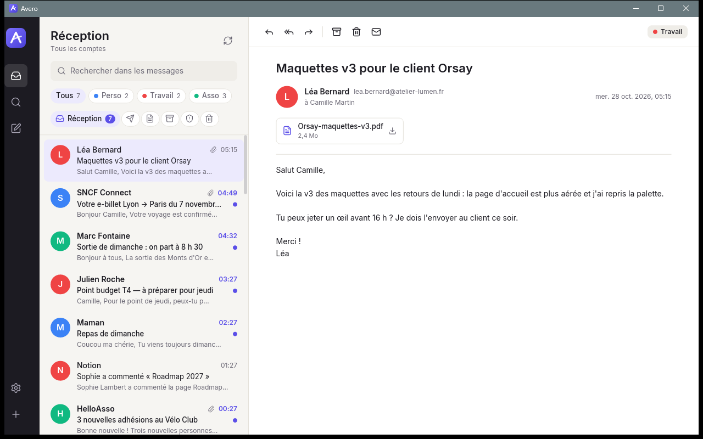
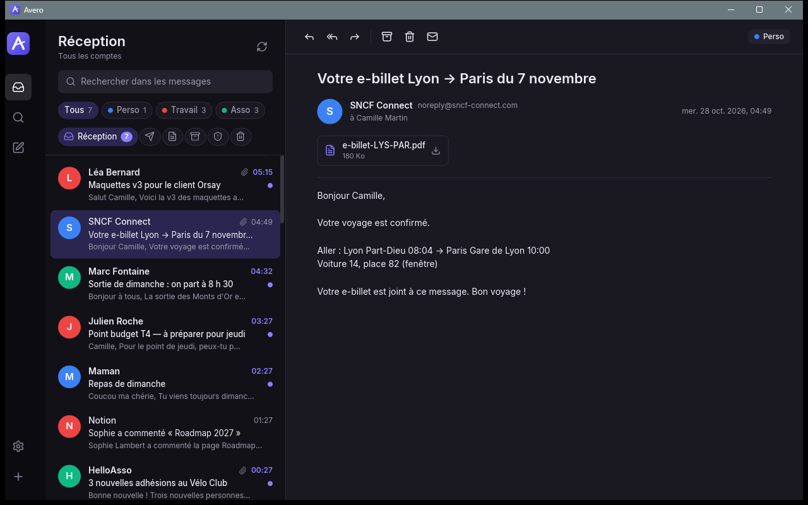
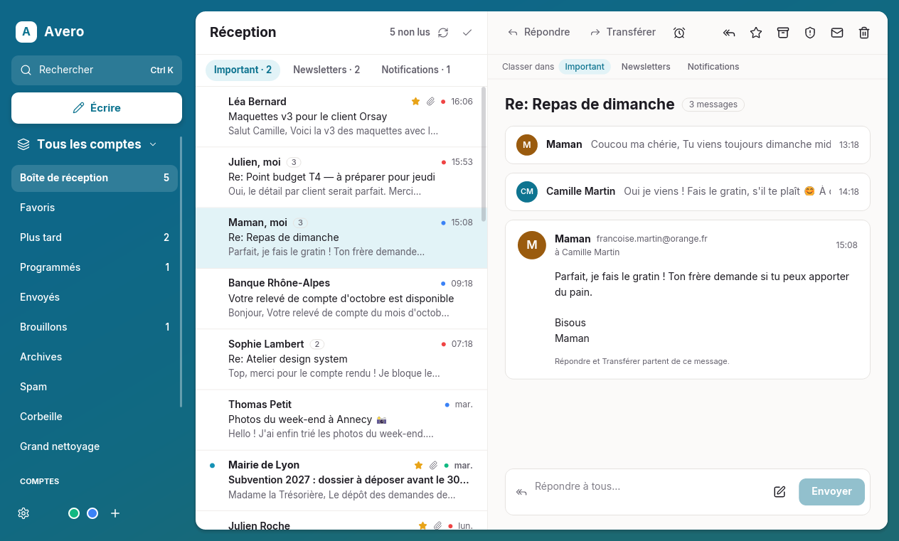
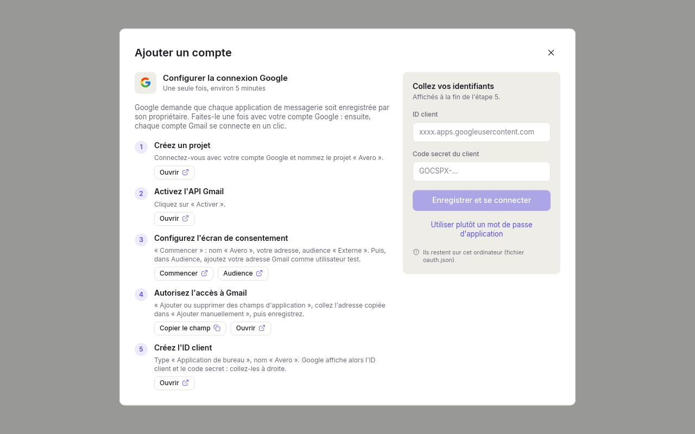

# Avero

Avero is a lightweight, open source desktop email client written in Rust. It is fast and frugal with memory, has a native UI (no Electron, no webview, no remote content) and shows several IMAP accounts in one unified inbox.

**Status: V1 (early).** It works day to day for reading, searching, answering and sorting mail, but it is young: see "Known limitations".

Supported platforms: Windows, macOS and Linux. The interface is in French.







## Features

- **Easy account setup.** Type your address and Avero finds the servers by itself (built-in table, Thunderbird ISPDB, `autoconfig.<domain>`, then a guess). Gmail and Microsoft accounts can sign in with "Continuer avec Google / Microsoft" in the browser (OAuth2, PKCE). Other providers use a password or an app password. The IMAP and SMTP logins are tested before the account is saved.
- **Unified inbox** for all accounts, with a filter per account and the usual folders (Réception, Envoyés, Brouillons, Archives, Spam, Corbeille). Messages received by several of your accounts appear once.
- **Reading**: plain text (HTML is converted to text locally, nothing is downloaded from the web), attachments saved with the system "Save as" dialog, messages marked as read automatically.
- **Acting**: reply, reply all, forward (with the original attachments), write a new message with attachments (25 MB max), archive, delete (to the trash; from the trash, deleted for good after a confirmation), mark as unread. An archive or delete only leaves the local copy once the server has confirmed it; if it fails, the message comes back with the reason.
- **Search** over subjects, senders and downloaded message bodies (SQLite FTS5, works offline).
- **Staying up to date**: sync at start-up, every 5 minutes and with the refresh button; the list fills in while syncing; the bodies of the 30 newest inbox messages are downloaded in the background so they open instantly.
- **Account management**: rename, change password, reconnect (OAuth), edit the IMAP and SMTP servers ("Serveurs"), remove.
- **Light and dark themes**, following the system or chosen in the settings.
- Keyboard: `Ctrl+N` new message, `Ctrl+R` reply, `Ctrl+Enter` send, `Ctrl+F` search, `J` / `K` next / previous message, `Suppr` delete, `Échap` close.

Passwords and OAuth refresh tokens are stored only in the operating system's keyring (Windows Credential Manager, macOS Keychain, Secret Service on Linux), never in the database or in logs. IMAP uses implicit TLS only; SMTP uses implicit TLS or mandatory STARTTLS.

## Installation

### Windows

Download the files from the [Releases](https://github.com/LnYKLl/Avero/releases) page (Windows 10 or 11, 64-bit):

- **Installer** (`Avero-<version>-windows-x64-setup.exe`): installs Avero for your user only, without administrator rights (in `%LOCALAPPDATA%\Programs\Avero`), with a Start menu shortcut, an optional desktop shortcut and an uninstaller ("Apps" in the Windows settings). Uninstalling keeps your mail, settings and passwords.
- **Portable** (`Avero-<version>-windows-x64-portable.zip`): unzip it anywhere and run `avero.exe`, nothing to install. The data is still kept in your user folder (see "Where files are kept"). New-mail notifications appear under the name "Windows PowerShell" in this version, because Windows only shows an app's own name for apps that have a Start menu shortcut; the installer creates one.

`SHA256SUMS.txt` lists the checksums of both files (`sha256sum -c SHA256SUMS.txt`, or `Get-FileHash` in PowerShell).

The files are not signed yet, so Windows SmartScreen may show "Windows protected your PC" (« Windows a protégé votre ordinateur ») the first time. Click "More info" (« Informations complémentaires »), then "Run anyway" (« Exécuter quand même »).

On macOS and Linux, build Avero from source for now (below).

## Build and run

You need the stable Rust toolchain (https://rustup.rs). Then, from this folder:

```
cargo run --release -p avero-app
```

The first build takes a few minutes. The app draws its UI in software (tiny-skia), which keeps memory low (about 25 MB private memory in demo mode, see `docs/memory.md`). To use the GPU renderer (wgpu) instead, add `--features gpu`.

### Try it without an account (demo mode)

```
# PowerShell
$env:AVERO_DEMO = "1"; cargo run --release -p avero-app
# bash / zsh
AVERO_DEMO=1 cargo run --release -p avero-app
```

Demo mode uses an in-memory database with three made-up accounts and about forty French messages. Nothing touches the network or your real data. `AVERO_DEMO=empty` shows the welcome screen; `AVERO_DEMO=google-setup` (or `microsoft-setup`) opens the connection assistant (nothing is saved). `AVERO_THEME=dark` (or `light`) forces a theme without saving it.

### Gmail

- **With the Google button**: Google requires every app to have its own OAuth client, created by its owner in the Google Cloud console, so Avero cannot ship one. The first time, Avero opens a built-in assistant ("Configurer la connexion Google", about 5 minutes, once): each step has a button that opens the right console page, then you paste the client id and secret and Avero signs you in straight away. After that, every Gmail account is one click. The ids can be viewed (masked), changed or removed in Settings → "Connexion Google / Microsoft". Details and the manual way (`oauth.json`, compile-time variables): [docs/oauth-setup.md](docs/oauth-setup.md) (French).

  
- **With an app password**: turn on 2-step verification on your Google account, create an app password at https://myaccount.google.com/apppasswords, and paste it in Avero (spaces are removed automatically).

Outlook.com / Hotmail accounts only work with the Microsoft button, which also needs a client id: the same assistant guides you through the Microsoft Entra app registration (only the application id is needed).

## Where files are kept

- Database (`avero.db`): Windows `%APPDATA%\Avero\Avero\data`, macOS `~/Library/Application Support/org.Avero.Avero`, Linux `~/.local/share/avero`.
- Settings (`settings.json`, optional `oauth.json`): Windows `%APPDATA%\Avero\Avero\config`, macOS `~/Library/Application Support/org.Avero.Avero`, Linux `~/.config/avero`.

Removing an account in the settings deletes its local messages and its keyring entry; nothing is deleted on the server.

## Known limitations

- The V1 interface has mostly been exercised with the demo data and automated tests; testing against real servers is still limited. OAuth (Google, Microsoft) is implemented and its requests are checked against the real Google and Microsoft endpoints (ignored tests in `crates/avero-oauth/tests/live_endpoints.rs`), but a complete sign-in needs your own client id (in-app assistant) and is not covered by automated tests.
- Gmail: "Archiver" moves the message to "All Mail", which Avero does not sync (it duplicates every other folder), so archived Gmail messages leave Avero's view. The "Archives" tab is hidden when no account has a real archive folder.
- Only the special folders are synced (Réception, Envoyés, Brouillons, Archives, Spam, Corbeille); your own folders and Gmail labels are not shown yet.
- The first sync of a folder fetches its 2000 most recent messages; older ones are not downloaded.
- Only the inbox has its read flags and deletions resynchronised from the server; other folders only receive new messages.
- Messages are shown as plain text; there is no HTML view and inline images are not displayed.
- No drafts saving, no signatures, no threads (conversation view), no notifications yet.
- Search covers only bodies already downloaded (the 30 newest inbox messages, plus every message you opened).

## Tests

```
cargo fmt --check
cargo clippy --workspace --all-targets -- -D warnings
cargo test --workspace
```

## License

GPL-3.0-or-later. See [LICENSE](LICENSE). The Inter fonts are under the SIL Open Font License and the Lucide icons under the ISC licence (see `crates/avero-app/assets`).
